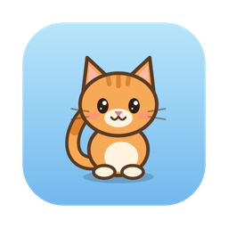
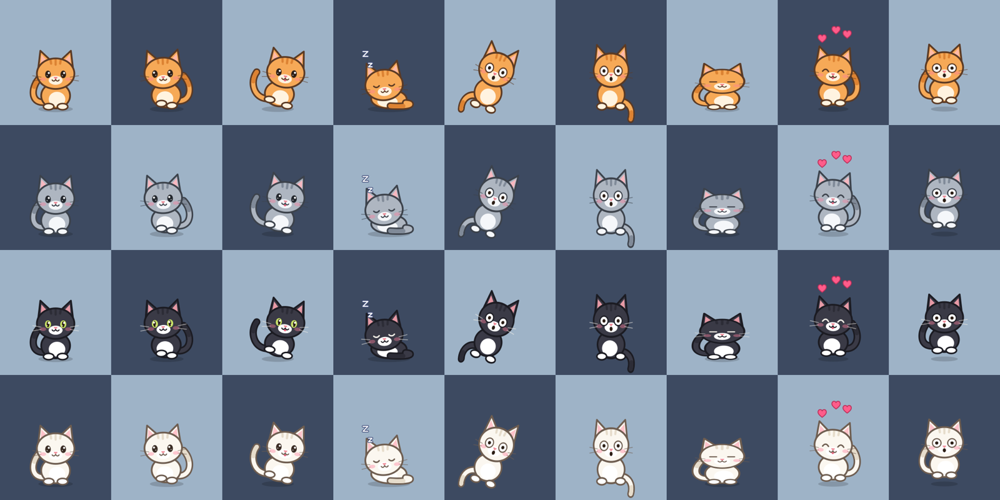

<p align="center"></p>

# Desktop Pet

A little cat that lives on your Mac desktop. It strolls along the bottom of the screen, naps, watches your cursor, and can be petted, picked up and tossed.



## What it does

- **On its own:** walks back and forth, sits and follows your cursor with its eyes, blinks, hops now and then, and curls up for naps.
- **Click it:** hearts. Rubbing the cursor back and forth over it works too. Clicking a sleeping cat startles it awake.
- **Drag it:** it dangles from the cursor by the scruff and swings as you move. Let go and it falls; fling it and it bounces off the screen edges.
- **Right-click it**, or use the paw icon in the menu bar: Come Here, Take a Nap, Chase the Cursor, four coats (Marmalade, Smoke, Tuxedo, Snow), three sizes, and Quit.

Clicks only land on the cat itself, so it never blocks what is underneath, and it stays out of full-screen apps.

## Build and run

You need macOS 13 or later and the Xcode command line tools (`xcode-select --install`). There are no other dependencies.

```bash
./build.sh
open build/DesktopPet.app
```

The app has no Dock icon. To quit, right-click the cat or use the paw icon in the menu bar.

## How it is put together

It is a native AppKit app in plain Swift. The cat is drawn entirely in code with Core Graphics, so there are no image files.

| File | What it holds |
| --- | --- |
| `Sources/PetBrain.swift` | Behavior: moods, walking, falling and bouncing, and the pose for each frame |
| `Sources/PetArt.swift` | Drawing: the cat, its coats, hearts and Zzz |
| `Sources/PetApp.swift` | The transparent floating window, mouse handling and the menu |
| `Sources/Snapshot.swift` | Renders the app icon and the picture above without opening a window |
| `Sources/main.swift` | Entry point |

To add a coat, add an entry to `Coat.all` in `Sources/PetArt.swift`; it shows up in the menu automatically.

To redraw the picture above after changing the art:

```bash
build/DesktopPet.app/Contents/MacOS/DesktopPet --poses docs/poses.png
```
